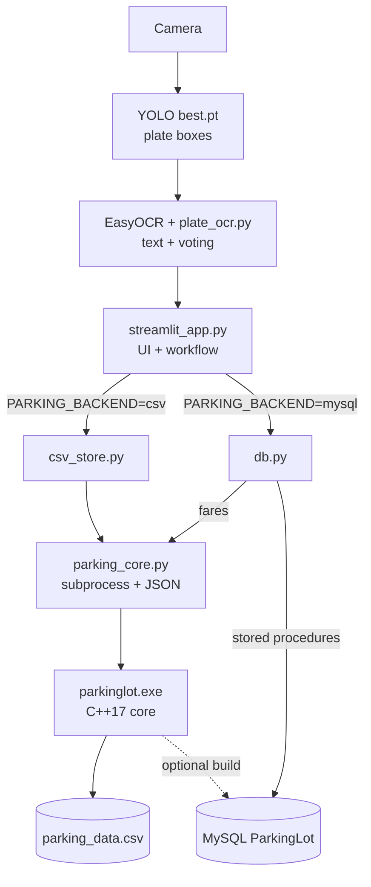
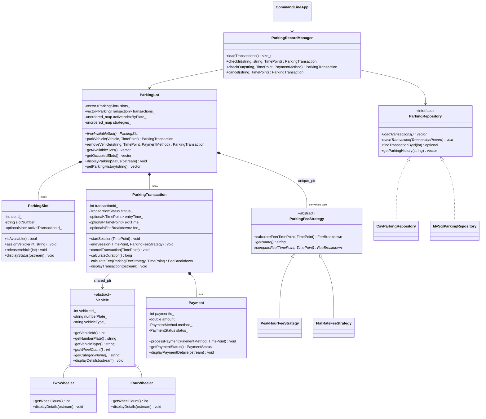

# Smart Parking Management System

A parking-lot management system with YOLO-based number-plate detection, a **C++17 object-oriented parking core**, a Streamlit web console, and two interchangeable storage backends: a CSV file or a MySQL database.

Second-year AI & Data Science mini-project (OOPL + DBMS). For the OOP viva, see **[OOP_VIVA_GUIDE.md](OOP_VIVA_GUIDE.md)**.

---

## Contents

1. [What is implemented](#what-is-implemented)
2. [Architecture](#architecture)
3. [Technology stack](#technology-stack)
4. [Build and run](#build-and-run)
5. [The C++ core](#the-c-core)
6. [OOP concepts in the code](#oop-concepts-in-the-code)
7. [Business rules (preserved from the C version)](#business-rules-preserved-from-the-c-version)
8. [Python ↔ C++ integration](#python--c-integration)
9. [YOLO / OCR pipeline](#yolo--ocr-pipeline)
10. [Storage: CSV and MySQL](#storage-csv-and-mysql)
11. [Tests and demonstration](#tests-and-demonstration)
12. [Migration notes (C → C++)](#migration-notes-c--c)
13. [MySQL database reference (DBMS part)](#mysql-database-reference-dbms-part)

---

## What is implemented

| Feature | Status |
|---|---|
| Plate detection (YOLO `best.pt`, single class `license_plate`) + EasyOCR + `plate_ocr.py` voting | Implemented (unchanged) |
| Streamlit console: Dashboard, Parking terminal, Map (slot grid + inspector), Records | Implemented (unchanged layout) |
| C++ core: vehicles, slots, sessions, fees, payments, parking lot | Implemented, unit-tested |
| Fare rule from `parkinglot.c` (base / peak, weekends & 18:00–22:00) | Implemented, verified against the original C program |
| CSV storage (`parking_data.csv`) owned by the C++ core | Implemented, tested (incl. legacy-file migration) |
| MySQL storage via `db.py` + stored procedures (Streamlit default) | Implemented (existing), fares now from the C++ core |
| MySQL storage inside the C++ core (`MySqlParkingRepository`) | **Optional** build (`-DPARKING_WITH_MYSQL=ON`); tested against a scratch copy of the schema. Not used by the Streamlit app |
| Payment | Records cash/UPI/card collected by the attendant; the UI shows a static QR image. **No online payment gateway** and no payment verification |
| Per-vehicle-type tariffs in the UI | **Future**: the UI always registers vehicles as `CAR` (as before) |

---

## Architecture



**Who owns what**

| Layer | Responsibility |
|---|---|
| `streamlit_app.py`, `ui/` | Pages, camera loop, YOLO/OCR calls, rendering |
| `plate_ocr.py` | Turning OCR text boxes into a validated plate string |
| `parking_core.py` | Starting `parkinglot.exe` and parsing its JSON reply. **No business rules** |
| `csv_store.py` | Adapts C++ replies to the dict shapes `db.py` returns, so the UI works with either backend |
| `db.py` + `database/schema.sql` | MySQL mode: stored procedures allocate slots and store sessions; fares come from the C++ core |
| `src/` (C++) | Parking business logic: slot allocation, session state machine, fee strategies, payments, CSV records |

---

## Technology stack

| Layer | Technology |
|---|---|
| Plate detection | YOLOv8 via `ultralytics` (`best.pt`) |
| OCR | EasyOCR |
| Parking core | C++17, STL; CMake or `build.bat` (g++/MinGW-w64) |
| UI | Streamlit |
| Storage | CSV (C++ `std::fstream`) or MySQL 8.0 (`mysql-connector-python`; optional C API in C++) |
| Config | `config/parking.cfg` (C++ core), `.env` via `python-dotenv` (Python) |

---

## Build and run

### 1. Build the C++ core (Windows)

**Option A: `build.bat` (no CMake needed).** Needs `g++` on `PATH`, e.g. MSYS2 UCRT64 (`C:\msys64\ucrt64\bin`).

```bat
build.bat          :: builds build\parkinglot.exe and build\parking_tests.exe
build.bat test     :: builds, then runs the C++ unit tests
```

**Option B: CMake** (VS Code *CMake Tools*, Visual Studio, or a terminal):

```bat
cmake -S . -B build
cmake --build build --config Release
ctest --test-dir build -C Release --output-on-failure
```

In VS Code, *Terminal → Run Build Task* runs `build.bat` (see `.vscode/tasks.json`). Build output goes to `build/`, which git ignores. The MinGW build links statically, so `parkinglot.exe` does not need MSYS2 DLLs at runtime.

### 2. Install the Python dependencies

```bat
pip install -r requirements.txt
```

### 3. Run the app

```bat
copy .env.example .env      :: then edit it
streamlit run streamlit_app.py
```

Choose the storage in `.env`:

| `PARKING_BACKEND` | Needs | What happens |
|---|---|---|
| `mysql` (default) | MySQL running with the `ParkingLot` schema (see [MySQL setup](#mysql-setup)) | Same behaviour as before; fares from the C++ core |
| `csv` | Nothing beyond the C++ build | The C++ core keeps all records in `parking_data.csv` |

Other optional settings: `YOLO_MODEL_PATH`, `PARKING_CSV_PATH`, `PARKING_CONFIG_PATH`, `PARKING_CORE_EXE` (see `.env.example`). Paths are resolved from the project folder, so nothing is hard-coded.

### 4. OOP demonstration (no camera, no database)

```bat
build\parkinglot.exe demo
```

---

## The C++ core

### Layout

```text
src/
├── main.cpp                         entry point -> CommandLineApp
├── app/
│   ├── CommandLineApp.hpp/.cpp      CLI: legacy fare mode + JSON commands
│   ├── DemoRunner.hpp/.cpp          `parkinglot demo`
│   └── JsonWriter.hpp/.cpp          small JSON builder
├── config/
│   ├── AppConfig.hpp/.cpp           rates, peak window, slot layout, storage
│   └── KeyValueFile.hpp/.cpp        key = value file reader (std::ifstream)
├── exceptions/ParkingException.hpp  exception hierarchy
├── models/
│   ├── Vehicle.hpp/.cpp             Vehicle (abstract), TwoWheeler, FourWheeler
│   ├── ParkingSlot.hpp/.cpp
│   ├── ParkingTransaction.hpp/.cpp  session state machine
│   ├── Payment.hpp/.cpp
│   └── FeeBreakdown.hpp
├── services/
│   ├── ParkingFeeStrategy.hpp/.cpp  abstract strategy + PeakHour / FlatRate
│   ├── ParkingLot.hpp/.cpp          coordinates slots, vehicles, sessions
│   └── ParkingRecordManager.hpp/.cpp  keeps lot and storage in sync
├── storage/
│   ├── ParkingRepository.hpp/.cpp   abstract storage interface
│   ├── TransactionRecord.hpp        flat record used by repositories
│   ├── CsvParkingRepository.hpp/.cpp
│   └── MySqlParkingRepository.hpp/.cpp   (optional build)
└── util/
    ├── TimeUtils.hpp/.cpp           std::chrono helpers, CSV time format
    └── Validation.hpp               custom templates: requireInRange, findOrNull
tests/                               C++ unit tests + Python integration tests
config/parking.cfg                   tunable values (defaults = original rules)
```

### Classes and responsibilities

| Class | Responsibility |
|---|---|
| `Vehicle` (abstract) | Id, normalised plate, type code; plate validation |
| `TwoWheeler`, `FourWheeler` | Category: type code `BIKE`/`CAR`, wheel count, display |
| `ParkingSlot` | One bay; enforces one active session per slot |
| `ParkingTransaction` | One session: `Created → Active → Completed`, or `Active → Cancelled`; duration, fee, payment |
| `Payment` | Amount, method, `Pending → Success`, timestamp |
| `ParkingFeeStrategy` (abstract) | Fee interface; validates the interval once for all policies |
| `PeakHourFeeStrategy` | The `parkinglot.c` rule |
| `FlatRateFeeStrategy` | The original CSV app's ₹1/min rule (`fee_strategy = flat`) |
| `ParkingLot` | First free slot, one active session per vehicle, pricing by vehicle type, history |
| `ParkingRepository` (abstract) | `loadTransactions`, `saveTransaction`, `findTransactionById`, `getParkingHistory` |
| `CsvParkingRepository` | `parking_data.csv` with safe writes |
| `MySqlParkingRepository` | Existing MySQL schema, prepared statements (optional) |
| `ParkingRecordManager` | Loads records into the lot at start-up and saves every change |
| `AppConfig` | Reads `config/parking.cfg`; defaults equal the original rules |
| `CommandLineApp` | Command-line interface used by Python |
| `ParkingException` + subclasses | Typed errors with a machine-readable `code()` |

### UML class diagram



### Command-line interface

```text
parkinglot <entry_unix_ts> <exit_unix_ts> [cancel]   legacy mode, same KEY=VALUE output as parkinglot.c
parkinglot rates | fare <entry> <exit> [--type CAR|BIKE]
parkinglot slots | active <plate> | history [--plate P] [--limit N]
parkinglot entry <plate> [--type CAR|BIKE] [--at <unix_ts>]
parkinglot exit <plate> [--method CASH|UPI|CARD] [--at <unix_ts>]
parkinglot cancel <plate> [--at <unix_ts>]
parkinglot status | demo | help
options: --config <file>  --data <csv>  --backend csv|mysql
```

JSON commands print one line: `{"ok": true, ...}`, or on failure `{"ok": false, "error_code": "NO_SLOT_AVAILABLE", "message": "..."}` with exit status 1.

---

## OOP concepts in the code

The short version for the viva is in [OOP_VIVA_GUIDE.md](OOP_VIVA_GUIDE.md).

| Concept | Where |
|---|---|
| **Classes & objects** | All classes above. `DemoRunner::run()` creates and connects real objects |
| **Encapsulation** | Every data member is private. Slot occupancy changes only through `ParkingSlot::assignVehicle/releaseVehicle`. Session state changes only through `ParkingTransaction::startSession/endSession/cancelTransaction`, which check the current state. Payment status changes only through `Payment::processPayment`. No setters exist for these. |
| **Abstraction** | `ParkingFeeStrategy` (pure virtual `computeFee`, `getName`, `describe`). `ParkingRepository` (pure virtual `loadTransactions`, `saveTransaction`, `describe`). `ParkingLot`, `ParkingRecordManager` and `CommandLineApp` use them only through these interfaces. Each concrete class is chosen in one factory: `createFeeStrategy()` and `CommandLineApp::makeRepository()`. |
| **Inheritance** | `TwoWheeler`/`FourWheeler : Vehicle` (`models/Vehicle.hpp`). `PeakHourFeeStrategy`/`FlatRateFeeStrategy : ParkingFeeStrategy`. `CsvParkingRepository`/`MySqlParkingRepository : ParkingRepository`. Exception subclasses of `ParkingException : std::runtime_error`. |
| **Runtime polymorphism** | `ParkingLot::removeVehicle()` calls `strategyFor(vehicle type)`, which returns a `ParkingFeeStrategy&` held in a `std::unique_ptr`, and then `calculateFee()` runs the derived `computeFee()`. `createFeeStrategy()` picks the class from config. `Vehicle::displayDetails()` is overridden. Exceptions are caught through base-class references. |
| **Constructors / destructors** | Validating constructors (`Vehicle`, `ParkingSlot`, `ParkingTransaction`, `Payment`, `ParkingLot`). Virtual destructors on every polymorphic base. RAII classes: `PreparedStatement`, `SqlTransaction`, the MySQL connection in `MySqlParkingRepository`, file streams. |
| **File handling** | `CsvParkingRepository::readFile/writeFile` (`std::ifstream`/`std::ofstream`, temp file + rename). `readKeyValueFile` (config and `.env`). |
| **Exception handling** | `exceptions/ParkingException.hpp`. Thrown in the models and services. Caught in `CommandLineApp::runCommand` (turned into JSON for Python), `ParkingRecordManager::loadTransactions` (adds the record id), and `DemoRunner::run` (section 9). |
| **STL** | `std::vector<ParkingSlot>`, `std::unordered_map` indexes, `std::optional`, `std::unique_ptr`/`std::shared_ptr`, `std::find_if`, `std::copy_if`, `std::stable_sort`, `std::chrono`, `std::filesystem`, `std::deque` (stable MySQL bind buffers) |
| **Custom templates** | `util/Validation.hpp`: `requireInRange<T>` (config hours/rates, payment amount) and `findOrNull<Map, Key>` (every map lookup in `ParkingLot` and `AppConfig::rateFor`) |

---

## Business rules (preserved from the C version)

From `parkinglot.c` (now `PeakHourFeeStrategy` and `CommandLineApp::runLegacyFare`):

- **Billing unit:** each real second of parking is billed as one "minute". This was the C program's demo time-compression and is kept unchanged.
- Every billed minute in the **peak window** (all of Saturday/Sunday, or 18:00–22:00 local time on any day) costs **₹0.80**. Every other minute costs **₹0.67**. Total = base amount + peak amount.
- Exit must be after entry, otherwise `ERROR=Invalid time`. `cancel` gives `STATUS=CANCELLED`, `AMOUNT=0`.
- Slot rules (from the original app and the stored procedure): the first free slot in slot order; a vehicle can have only one active session.

All values live in `config/parking.cfg`. If the file is missing, the built-in defaults are identical.

**Verification against the original C program.** The original `parkinglot.c` was compiled from git history and both programs were run on 3,000 random intervals:

- every stay up to about 5.5 hours produced byte-identical output;
- base/peak minute splits matched in all cases.

For long stays (multi-day), the C program sometimes printed amounts one paisa off. It computed money in `float`: for example, 219337 × 0.67 = 146955.79, but C printed 146955.80. The C++ core uses `double` and prints the exact amount. **This is the only behavioural change, and it is a precision fix.**

The C++ peak strategy classifies a whole local hour at once instead of calling `localtime` once per second. A unit test checks it against a literal port of the C per-second loop.

---

## Python ↔ C++ integration

The original design started the C executable as a subprocess. The same approach is kept, because it needs no Python build tooling and is easy to explain:

1. `parking_core.run(command, *args)` starts `build/parkinglot.exe` with `--config config/parking.cfg --data parking_data.csv`, using paths computed from the project folder.
2. The core prints one JSON line. On `"ok": false`, the bridge raises `ParkingCoreError(message, code)`.
3. `streamlit_app.py` shows the message instead of failing silently. Example: a manual plate typed in the same second as its entry shows *"Exit not recorded — Invalid time: exit must be after entry"*.

What changed in the Python files:

| File | Change |
|---|---|
| `parking_core.py` (new) | Bridge: find exe, run, parse JSON, raise errors |
| `csv_store.py` (new) | `db.py`-compatible functions for the CSV backend |
| `db.py` | `call_c_fare_calculator` now calls the C++ core and raises on failure. Previously a failed call silently produced a ₹0 fare. New `checkout_vehicle()` |
| `streamlit_app.py` | Backend switch (`store = csv_store / db`); rates read from the core; model and QR paths relative to the project. The exit path no longer computes a fallback fare in Python: if pricing fails, the exit is not recorded and the reason is shown. |
| `ui/components.py` | Status box and fare box take labels/rates as parameters instead of hard-coding "MySQL" and "₹0.67" |

The old Python fallback fare billed everything at the base rate. It would have charged the wrong amount silently, and it duplicated a business rule in Python. That is why it was removed.

---

## YOLO / OCR pipeline

Unchanged:

- `best.pt` is a YOLOv8 **detection** model with one class, `license_plate`. It finds plate boxes only; it does not read text, classify vehicle types, or detect free slots.
- Each box is cropped and padded, upscaled and sharpened (`preprocess_plate`), then read by EasyOCR.
- `plate_ocr.py` joins split text boxes, fixes look-alike characters against Indian plate layouts, and scores candidates. A plate must win in 2 frames (`VOTE_THRESHOLD`) within 45 s.
- The vehicle type passed to the core is always `CAR`, as before; the model cannot tell bikes from cars.

---

## Storage: CSV and MySQL

### CSV (`parking_data.csv`, owned by the C++ core)

- **Compatible with the original file.** The first four columns are unchanged (`Number Plate, Entry Time, Exit Time, Slot`, times as `dd/mm/YYYY HH:MM:SS`). New columns are appended: `Transaction ID, Vehicle Type, Status, Base/Peak Minutes, Base/Peak Rate, Base/Peak Amount, Total Fare, Payment Method/Status/Time`.
- **Legacy files** from the original app are read as-is:
  - ids follow row order;
  - an empty exit time means ACTIVE;
  - the old app never stored a fare, so these rows show "—".

  Before such a file is first rewritten in the new layout, an untouched copy is saved as `parking_data.csv.legacy-backup`.
- **Safe writes:** each save writes `parking_data.csv.tmp` completely, then renames it over the real file.
- **Malformed rows** are reported as warnings and written back verbatim; they are never dropped. A file with an unknown header is refused and left untouched.
- **Inconsistent data** fails loudly and names the record, for example two ACTIVE sessions in one slot.
- To bring over records from the old `main`-branch app, copy its `parking_data.csv` into the project folder.

### MySQL setup

1. MySQL 8.0 running; credentials in `.env` (`DB_HOST`, `DB_PORT`, `DB_NAME`, `DB_USER`, `DB_PASSWORD`).
2. Create the schema and seed data: run `database/schema.sql` then `database/seed.sql` (e.g. in MySQL Workbench), or use `python setup_db.py` if you have the local `database/init_db.py` and `seed_runner.py` helpers.
3. Set `PARKING_BACKEND=mysql` (the default).

`database/schema.sql` change: `RegisterVehicleEntry` now selects the free slot `... FOR UPDATE`, so two concurrent entries cannot be given the same slot. An existing database keeps the old procedure until the schema is re-applied. The local `database/init_db.py` has its own copy of that line.

### Optional: MySQL inside the C++ core

```bat
cmake -S . -B build-mysql -DPARKING_WITH_MYSQL=ON -DMYSQL_ROOT="C:/Program Files/MySQL/MySQL Server 8.0"
cmake --build build-mysql
set PATH=C:\Program Files\MySQL\MySQL Server 8.0\lib;%PATH%
build-mysql\parkinglot.exe --backend mysql slots
```

- It uses the existing schema and reads `DB_*` from the environment or from `.env`.
- Every statement that carries a value is a prepared statement.
- A new session claims its slot atomically: `UPDATE ... WHERE slot_number=? AND status='AVAILABLE'`. Each save runs in one SQL transaction, with RAII rollback.
- Sessions for `TRUCK`/`OTHER` vehicles are skipped with a warning, because the C++ model only has `CAR` and `BIKE`.
- The Streamlit app does **not** use this path; in MySQL mode it keeps the stored procedures.
- **Tested:** built with MinGW against MySQL 8.0's `libmysql`, and exercised against a scratch copy of the schema (entry, duplicate entry, exit + payment, cancel, slot conflict, bad password). Not tested with MSVC or on Linux.

---

## Tests and demonstration

| What | Command | Covers |
|---|---|---|
| C++ unit tests (31) | `build.bat test` or `ctest --test-dir build` | Slot allocation, occupied slot, release on exit, duration, original fee/surcharge rules (+ comparison against the per-second C loop), legacy CLI output, invalid transitions, CSV save/load, missing/malformed/legacy/foreign files, derived vehicles, runtime polymorphism, templates, config validation, JSON CLI errors |
| Python integration (11) | `python -m pytest tests -q` | Bridge, error propagation, CSV store cycle, legacy CSV, `db.py` fares, and the real Streamlit app run headlessly in CSV mode (all pages, plus a detected-plate entry → exit) |
| OOP demonstration | `build\parkinglot.exe demo` | The 10 viva points, using the real classes and a temporary CSV |

The Python tests need the C++ core built first. They use a temporary CSV file, so they touch neither `parking_data.csv` nor MySQL.

---

## Migration notes (C → C++)

- `parkinglot.c`, `parkinglot.exe` and `a.exe` were removed: they are replaced by `src/` and its `build/` output. The C source is still in git history: `git show mysql-integration:parkinglot.c`.
- The legacy call `parkinglot.exe <entry> <exit> [cancel]` still works with identical output, so older scripts keep working.
- `.gitignore` started with a byte-order mark, so its `parking_data.csv` rule never matched. It has been rewritten, and now also ignores `build/` and `*.exe`.
- Defects found and fixed during the migration:
  - the C `float` paisa rounding;
  - the silent ₹0 fare when the exe failed;
  - the hidden Python fallback fare;
  - the unlocked slot selection in the stored procedure.

**Known limitations**

- The CSV backend expects one writer at a time (one Streamlit session). MySQL handles concurrency.
- The 1-second-equals-1-minute billing is a demo setting carried over from the C version.
- There is no payment gateway.

---

## MySQL database reference (DBMS part)

**Database:** `ParkingLot` on `localhost:3306` (configurable via `.env`).

### Tables

#### vehicles
| Column | Type | Notes |
|---|---|---|
| vehicle_id | INT UNSIGNED PK | Auto-increment |
| number_plate | VARCHAR(20) UNIQUE | Not null |
| vehicle_type | ENUM | CAR/BIKE/TRUCK/OTHER |
| owner_name | VARCHAR(100) | Optional |
| created_at | DATETIME | Auto |
| updated_at | DATETIME | Auto |

#### parking_slots
| Column | Type | Notes |
|---|---|---|
| slot_id | INT UNSIGNED PK | Auto-increment |
| slot_number | VARCHAR(10) UNIQUE | '1'-'30' |
| slot_type | ENUM | STANDARD/COMPACT/LARGE |
| floor | TINYINT | 1 or 2 |
| zone | CHAR(1) | A/B/C/D |
| status | ENUM | AVAILABLE/OCCUPIED/MAINTENANCE |

#### parking_sessions
| Column | Type | Notes |
|---|---|---|
| session_id | INT UNSIGNED PK | Auto-increment |
| vehicle_id | INT FK | References vehicles |
| slot_id | INT FK | References parking_slots |
| entry_time | DATETIME | Auto on insert |
| exit_time | DATETIME | NULL until exit |
| duration_seconds | INT | Computed on exit |
| base_minutes | INT | Non-rush minutes |
| peak_minutes | INT | Rush-hour minutes |
| base_rate | DECIMAL | Rs/min (0.67) |
| peak_rate | DECIMAL | Rs/min (0.80) |
| base_amount | DECIMAL | base_minutes * base_rate |
| peak_amount | DECIMAL | peak_minutes * peak_rate |
| total_fare | DECIMAL | base + peak |
| is_rush_hour | TINYINT | 1 if any peak minutes |
| session_status | ENUM | ACTIVE/COMPLETED/CANCELLED |
| payment_status | ENUM | PENDING/PAID/WAIVED |

#### payments
| Column | Type | Notes |
|---|---|---|
| payment_id | INT UNSIGNED PK | Auto-increment |
| session_id | INT UNIQUE FK | References parking_sessions |
| amount | DECIMAL | Fare amount |
| payment_method | ENUM | CASH/UPI/CARD/WAIVED |
| payment_time | DATETIME | Auto |
| payment_status | ENUM | SUCCESS/FAILED/REFUNDED |
| transaction_ref | VARCHAR | UPI/card ref ID |

#### rush_hours
| Column | Type | Notes |
|---|---|---|
| rush_hour_id | INT PK | Auto-increment |
| description | VARCHAR | Human-readable name |
| rule_type | ENUM | WEEKEND or TIMERANGE |
| start_time / end_time | TIME | For TIMERANGE rules |
| multiplier | DECIMAL | Price multiplier |
| is_active | TINYINT | 1 = active |

#### pricing_rules
| Column | Type | Notes |
|---|---|---|
| rule_id | INT PK | Auto-increment |
| vehicle_type | ENUM | CAR/BIKE/TRUCK/OTHER |
| base_rate_per_min | DECIMAL | Rs 0.67 for CAR |
| peak_rate_per_min | DECIMAL | Rs 0.80 for CAR |
| effective_from / effective_to | DATE | Validity (NULL end = ongoing) |
| is_active | TINYINT | 1 = active |

### Relationships

```text
vehicles ─────────< parking_sessions >──────── parking_slots
                          │
                          └────────< payments
```

- **vehicles → parking_sessions:** one vehicle, many sessions (one ACTIVE at a time)
- **parking_slots → parking_sessions:** one slot, many sessions (one ACTIVE at a time)
- **parking_sessions → payments:** at most one payment per session (UNIQUE FK)

### Normalization

- **1NF:** atomic columns, no repeating groups.
- **2NF:** no partial dependencies.
- **3NF:** no transitive dependencies. Pricing lives in its own table; the rates are copied into each session for audit.

### Views

| View | Purpose |
|---|---|
| active_parking_sessions | Currently parked vehicles with slot and duration |
| parking_history | Complete history with vehicle, slot, fare, payment |
| daily_revenue | Revenue grouped by date |
| slot_availability | All slots with availability flag |
| vehicle_parking_history | Per-vehicle aggregated stats |
| rush_hour_sessions | Sessions where rush-hour pricing was applied |

### Stored procedures, functions, triggers

- **RegisterVehicleEntry(plate, type)**: upserts the vehicle, blocks a second active session, locks and assigns the first available slot, and creates the session. Returns session_id, slot_number, message.
- **ProcessVehicleExit(plate, base_minutes, peak_minutes, base_amount, peak_amount, total_fare, is_rush_hour, method)**: completes the active session with the fare from the C++ core and inserts the payment.
- **CalculateParkingDuration(entry, exit)** → seconds (minimum 60). **CalculateBaseFare(minutes, rate)** → DECIMAL.
- **trg_slot_occupied_on_entry**, **trg_slot_available_on_exit**, **trg_prevent_duplicate_entry**.

### Entry / exit flow (MySQL mode)

```text
OCR plate → db.get_active_session(plate)
  none   → db.register_vehicle_entry → RegisterVehicleEntry → trigger marks slot OCCUPIED
  active → db.checkout_vehicle → C++ fare (parking_core) → ProcessVehicleExit
           → trigger marks slot AVAILABLE, payment row inserted
```

### Database files

| File | Purpose |
|---|---|
| `database/schema.sql` | Tables, indexes, views, triggers, procedures, functions |
| `database/seed.sql` | Sample data |
| `database/queries.sql` | Demonstration queries for the DBMS viva |

SQL features shown: SELECT, INSERT, UPDATE, DELETE, INNER/LEFT JOIN, GROUP BY, HAVING, ORDER BY, aggregates, subqueries, views, indexes, foreign keys, constraints, transactions, `SELECT ... FOR UPDATE`, stored procedures, functions, triggers, ENUM, ON DUPLICATE KEY UPDATE, SIGNAL SQLSTATE, TIMESTAMPDIFF, CASE WHEN, NULLIF, COALESCE.
